# FR5-Print

FAIRINO FR5 협동로봇을 펜 플로터처럼 쓰는 단독 웹 프로그램이다. 작업판(판) 좌표 위의 그림 · 도형 · 글씨 · 사진 · G-code · SVG · 좌표 파일 · 배열 찍기를 공구 끝으로 따라간다. 획 사이는 들어서 옮기고, 획은 내려서 그린다. 같은 경로를 펜 · 스포이드 · 바늘 끝에 그대로 쓴다.

작업 녹화 도구 `fr5cam` 이 함께 있다.

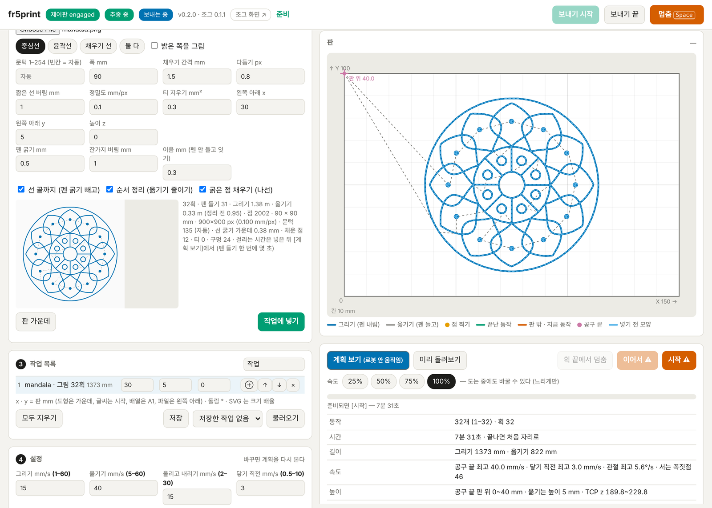

**그림 1.** fr5print 화면. 왼쪽은 사진 · 그림 탭(중심선)이고 오른쪽은 판 그림과 계획 요약이다. 파란 선은 그리는 길, 점선은 펜을 들고 옮기는 길이다.

`fr5print 0.2.0` · `fr5cam 0.1.0` · 2026-11-24

---

## 1. 요약

| 항목 | 값 |
|---|---|
| 입력 | 손 그림 · 도형 9종 · 한 획 글꼴 · 사진/선 그림(PNG · JPG) · G-code · SVG · 좌표 CSV · 웰 플레이트 배열 · 그리퍼 · 기다리기 · 멈춤 |
| 사진 → 선 | 중심선(선 가운데 한 번) · 윤곽선 · 채우기 선 · 둘 다 |
| 좌표 | 판 3점 또는 1점 + 크기. 공구 끝 = TCP + 공구 축 · 공구 길이 |
| 계획 | 0.5 mm 간격 IK, 굽음 · 관절 속도 · 가속 한도로 속도 결정, 50 Hz 관절 명령 |
| 보내기 전 검사 | 관절 한계 · J6 · 손목 특이점 · IK 오차 0.5 mm · 판 아래 · 판 밖 · 작업 상자 · 책상 · 2시간 · 60 m |
| 실행 | 속도 25 – 100 %(도는 중 변경), 멈춤(Space), 획 끝에서 멈춤, 이어서, 바로 따라 그리기, 허공 시험 |
| 녹화 | fr5cam: 카메라별 MJPEG AVI + 장면별 TCP · 관절 CSV, fr5print 실행에 맞춘 자동 녹화, MP4 |
| 중심선 정확도 (합성 도형) | 원 중심선 반지름 오차 최대 0.124 mm(선 굵기 1.87 mm), 합성 도형 41/42 통과 |
| 펜 들고 옮기는 길이 | 순서 정리로 24 – 35 % 로 줄어듦 (그림 4장) |
| 실물 | 펜 그리기 동작 확인. 실물 선 위치 오차는 아직 재지 않음 |

## 2. 사진 · 그림 → 중심선

선 그림은 가운데 선을 한 번만 그린다. 갈림길(X · T · +)에서는 가장 곧게 이어지는 가지끼리 이어 획이 끊기지 않는다. 모서리는 날카롭게 남고, 선 끝은 펜 반지름만큼 덜 그어 그림과 같은 길이가 된다. 굵은 점은 나선으로 채운다.

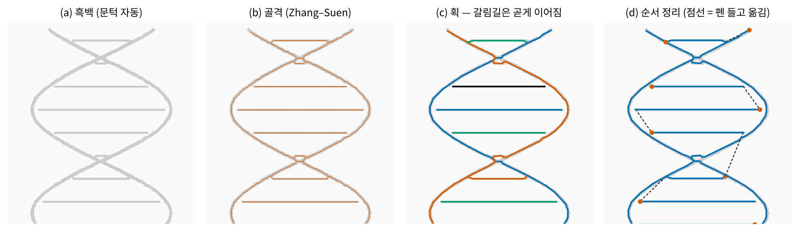

**그림 2.** (a) 흑백 (b) 골격 (c) 획 — 색이 같으면 한 획 (d) 그리는 순서. 주황 점은 획 시작이다.

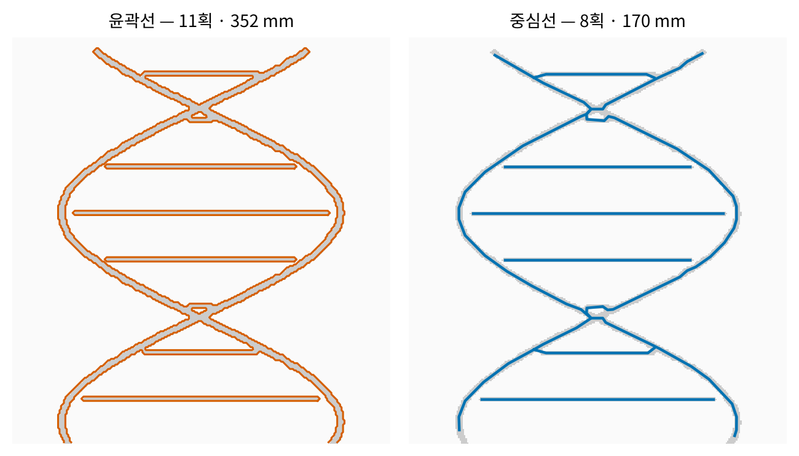

**그림 3.** 같은 그림의 윤곽선과 중심선. 윤곽선은 선 하나를 양쪽 테두리로 두 번 그린다. 중심선은 그리는 길이가 절반 아래로 준다.

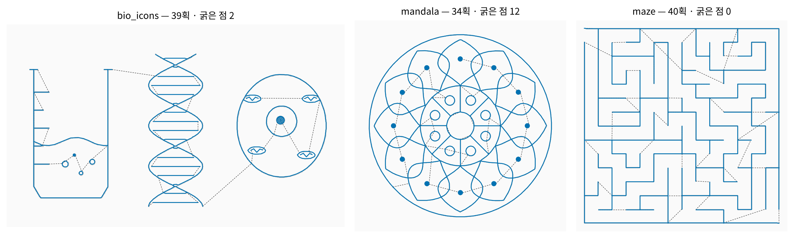

**그림 4.** 시험 그림 세 장(`samples/`). 점선은 순서 정리 뒤 펜을 들고 옮기는 길이다.

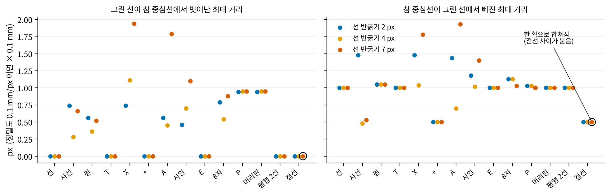

**그림 5.** 합성 도형 14종 × 선 반굵기 3가지. 참 중심선과 그린 선 사이 최대 거리(px)다. 정밀도 0.1 mm/px 에서 1 px = 0.1 mm. 동그라미 친 점은 통과 못 한 경우(점선 사이가 붙어 한 획이 됨)다.

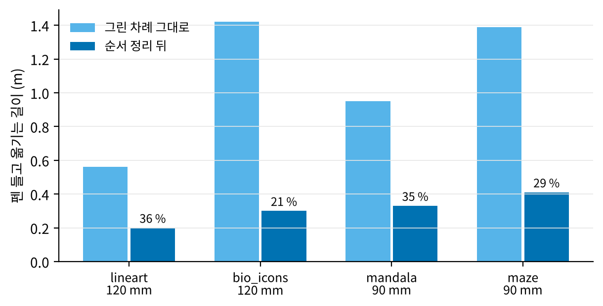

**그림 6.** 순서 정리 전 · 후 펜 들고 옮기는 길이.

처리 순서와 칸 설명은 [docs/04_image_to_path.md](docs/04_image_to_path.md) 에 있다.

## 3. 좌표와 길

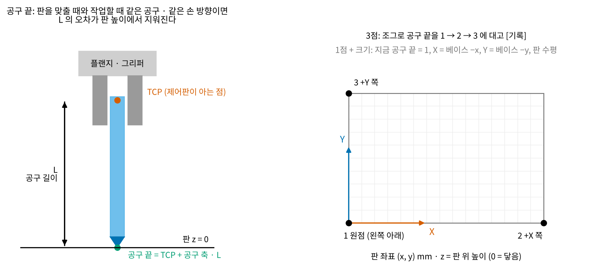

**그림 7.** 공구 끝과 판 좌표. 판은 3점(원점 · +X · +Y) 또는 1점 + 크기로 맞춘다.

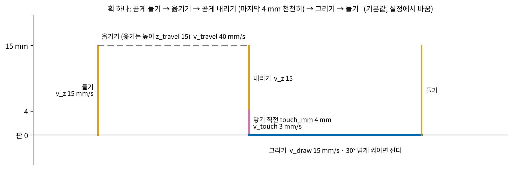

**그림 8.** 획 하나의 높이 변화(기본값).

## 4. 녹화 (fr5cam)

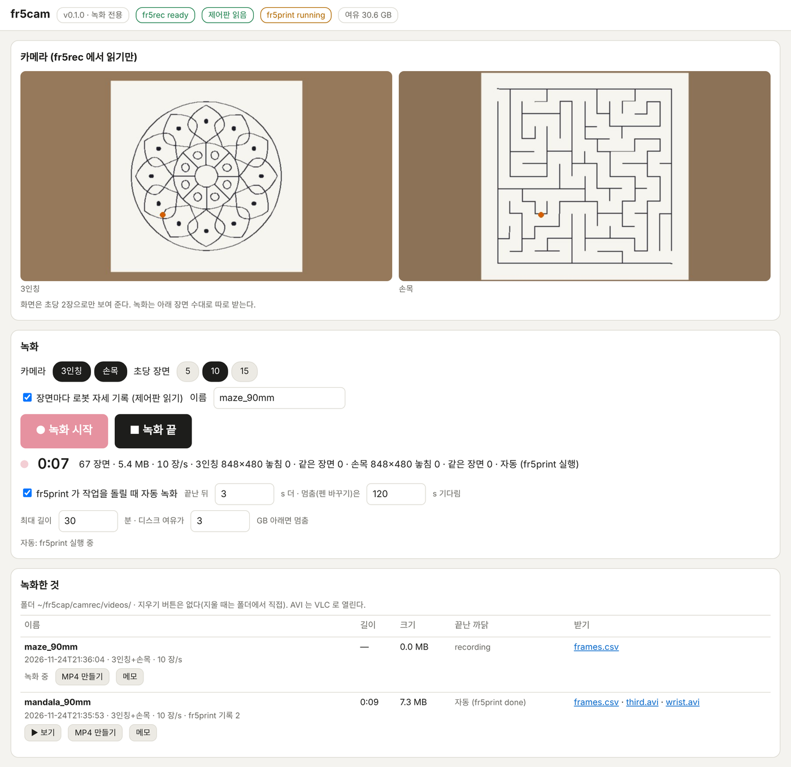

**그림 9.** fr5cam. 카메라 영상은 수집 프로그램(fr5rec)이 열어 둔 것을 읽기만 한다. 녹화 하나는 카메라별 AVI, 장면별 TCP · 관절 CSV, meta.json 으로 남는다.

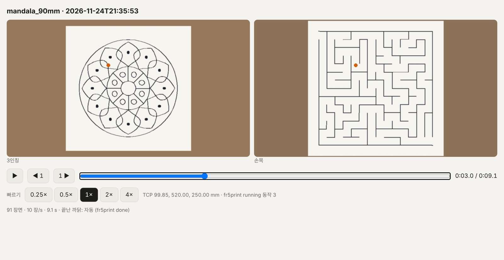

**그림 10.** 브라우저 안 돌려 보기. 속도 0.25 – 4×, 한 장씩, 그 장면의 TCP 가 함께 보인다.

## 5. 파일

```
fr5cap/
  print/fr5print.py      fr5print 0.2.0 — 화면 포함 한 파일 (포트 8796)
  camrec/fr5cam.py       fr5cam 0.1.0 — 녹화 (포트 8798, 표준 라이브러리만)
  jog/fr5jog_ui.py       조그 · 보내기 (fr5print 가 읽음, 0.1.1)
  pour/pose_go.py        제어판 HTTP · UDP, 자세 이동
  pour/pour_run.py       FK · IK · 검사 · 책상 높이
samples/                 시험 그림 3장 (직접 그림)
tests/centerline/        중심선 단위 시험 (Node.js)
docs/                    설명서
fig/                     그림
```

| 파일 | md5 |
|---|---|
| `fr5cap/print/fr5print.py` | `40596bf62d36605b83e29dd891a9f98f` |
| `fr5cap/camrec/fr5cam.py` | `6331acdcebd5dfc19923196e17b52617` |
| `fr5cap/jog/fr5jog_ui.py` | `d60f8e6e1fe00057ec2645a65b0d940c` |
| `fr5cap/pour/pose_go.py` | `7545987c4dcc7f68c71f2496c6e5cee3` |
| `fr5cap/pour/pour_run.py` | `81c5b7176e9f7704dc100a5f714b9f07` |

## 6. 빠른 시작

제어 PC(FR5 제어판이 도는 컴퓨터)에서:

```bash
cp -r fr5cap/* ~/fr5cap/
python3 ~/fr5cap/print/fr5print.py        # http://localhost:8796
python3 ~/fr5cap/camrec/fr5cam.py         # http://localhost:8798 (녹화, 선택)
```

다른 컴퓨터의 브라우저에서 볼 때:

```bash
ssh -N -L 8796:127.0.0.1:8796 -L 8798:127.0.0.1:8798 <user>@<control-pc>
```

순서: 제어판 [조작 시작] → fr5print [보내기 시작] → 제어판 리더 추종 시작 → 머리띠가 '준비'가 되면 공구 길이 → 판 맞추기 → 작업 → [계획 보기] → [시작].

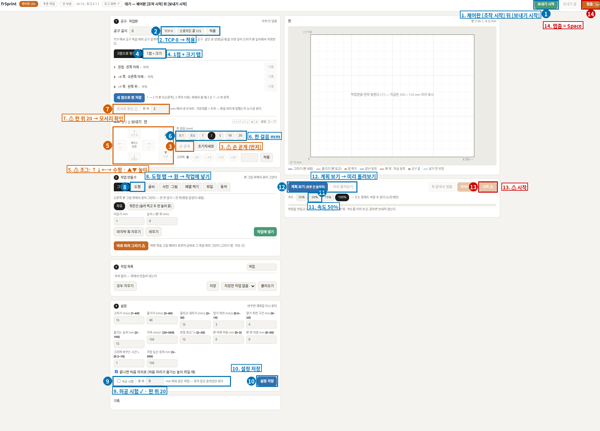

**그림 11.** 처음 쓰는 순서(0.1 화면). 0.2 는 사진 · 그림 탭만 바뀌었다.

## 7. 문서

| 문서 | 내용 |
|---|---|
| [01_setup](docs/01_setup.md) | 설치 · 켜기 · 포트 · 의존 파일 · 다른 프로그램과 같이 쓰기 |
| [02_bed_tool](docs/02_bed_tool.md) | 공구 끝 · 판 맞추기 · 모서리 확인 · 허공 시험 |
| [03_jobs](docs/03_jobs.md) | 작업 종류와 파일 형식 · 작업 목록 · 저장 |
| [04_image_to_path](docs/04_image_to_path.md) | 사진 → 선: 네 방식, 중심선 처리, 칸 설명, 시험 |
| [05_planning](docs/05_planning.md) | 길 구조 · 시간 계산 · 검사 · 설정값과 한계 |
| [06_run](docs/06_run.md) | 실행 · 속도 · 멈춤 · 이어서 · 바로 따라 그리기 · 실행 기록 |
| [07_fr5cam](docs/07_fr5cam.md) | 녹화 프로그램 |
| [08_api](docs/08_api.md) | HTTP API |
| [09_tests](docs/09_tests.md) | 시험 결과 |
| [10_limits_next](docs/10_limits_next.md) | 한계 · 다음 단계(곡면 · 3D) |
| [CHANGELOG](CHANGELOG.md) | 판 기록 |

## 8. 한계

- 실물 선 위치 오차, 펜 누르는 힘은 아직 재지 않았다.
- 판은 평면 하나, 공구는 하나, 손 방향은 작업 내내 고정이다. 곡면 · 기울인 공구는 [10_limits_next](docs/10_limits_next.md).
- 물체(펜 홀더 · 비커 등)와의 충돌은 검사하지 않는다. 미리 돌려보기로 확인한다.
- 글꼴은 영문 대문자 · 숫자 · 기호 일부다. 한글은 SVG 경로로 바꿔 가져온다.
