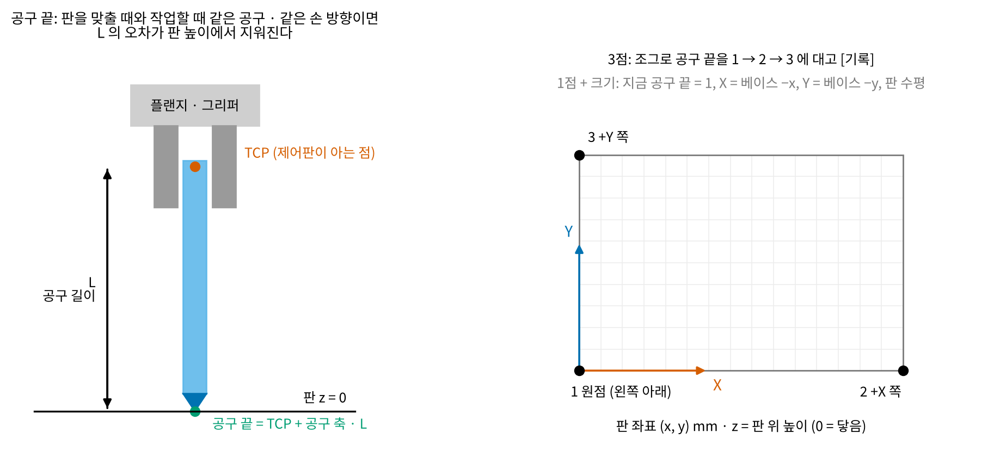

# 02. 공구 끝 · 판

## 공구 끝

- 움직이는 점은 공구 끝이다: 공구 끝 = TCP + 공구 축(R[:, 2]) · L. L = 공구 길이(mm, 0 – 400).
- 화면에서 [TCP 0] · [스포이드 끝 225] 를 고르거나 직접 넣고 [적용].
- 손 방향은 작업 내내 시작 자세 그대로다. 손을 먼저 곧게 세운다(조그 [손 곧게]).
- 판을 맞출 때와 작업할 때 공구 · 손 방향 · 쥔 자리가 같으면, L 의 오차는 판 높이에 함께 들어가 지워진다. 그래서 펜을 쥐고 TCP 0 으로 판을 맞춰도 된다.
- 평행 그리퍼로 펜을 쥐면 쥔 폭 · 쥔 높이에 따라 펜 끝 높이가 바뀐다. 펜을 다시 쥐면 판을 다시 맞춘다.

## 판 맞추기

판 좌표: x · y = 판 위 mm, z = 판 위 높이(0 = 닿음). 판 그림의 왼쪽 아래가 원점이다.

### 3점

1. 조그로 공구 끝을 판의 원점(왼쪽 아래)에 대고 [기록 1].
2. +X 쪽(오른쪽 아래)에 대고 [기록 2].
3. +Y 쪽(왼쪽 위)에 대고 [기록 3].
4. [세 점으로 판 저장].

- 점 사이 20 mm 이상, 위에서 볼 때 3 은 1 → 2 의 왼쪽, 기울기 45° 까지.
- 세 점의 공구 길이가 같아야 한다. 세 점 사이 손 방향 차는 저장 뒤 알림에 나온다.
- 조그 한 걸음을 0.1 – 0.5 mm 로 줄여 닿게 한다.

### 1점 + 크기

- 지금 공구 끝 = 원점(왼쪽 아래). 판은 수평, X = 베이스 −x 방향, Y = 베이스 −y 방향(조그 → · ↑).
- 폭 · 높이(20 – 600 mm)를 넣고 [저장].
- **공구 끝이 판에 닿은 높이에서 저장한다.** 허공에서 저장하면 판 높이가 그만큼 위로 잡혀 그리는 높이가 틀어진다.

새로 맞추면 앞 판은 `bed.json.bak_<시각>` 으로 남는다. 판 · 공구 길이가 바뀌면 그 전에 만든 계획은 거절된다.

## 모서리 확인 ⚠

- [모서리 확인]: 판 위 h mm(기본 3)에서 네 모서리와 가운데를 1 초씩 들른다.
- 네 모서리에서 공구 끝 높이가 같아 보이면 판이 바르게 맞은 것이다.
- 도중에 멈추면 [이어서]로 멈춘 자리에서 이어 간다.

## 허공 시험

- 설정 '허공 시험'(air_dz, 0 – 100 mm)을 켜면 같은 작업을 판 위 air_dz 띄워 한다.
- 실물에서 처음 돌리는 작업은 허공 시험 → 속도 50 % 실제 순서로 한다.

## 펜

- 위치 제어라 딱딱한 펜은 닿음 · 안 닿음이 판 높이 오차에 따라 갈린다. 스프링으로 눌리는 홀더가 맞다.
- 판 아래 허용(z_below, 0 – 3 mm)을 0.5 – 1 mm 로 두면 살짝 눌러 그린다.
- 펜 굵기는 사진 → 선의 '펜 굵기' 칸에 넣는다(선 끝 · 굵은 점 채우기에 쓰임).
