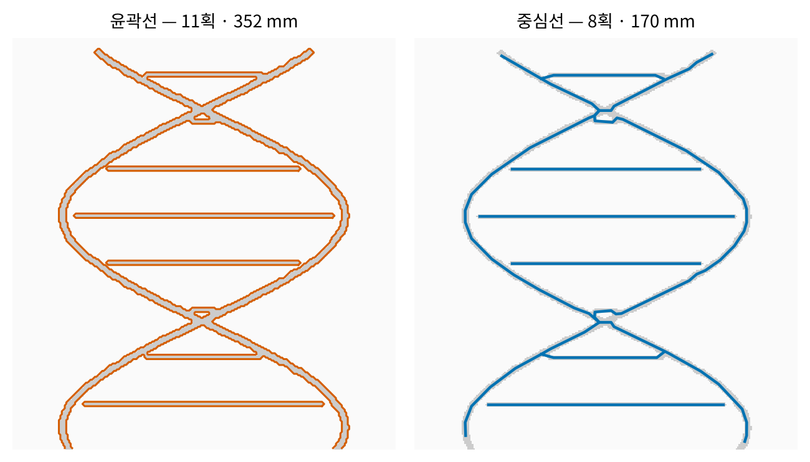
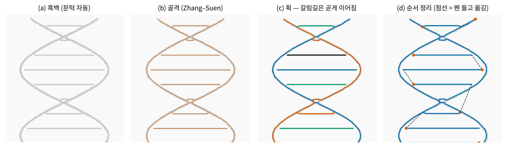
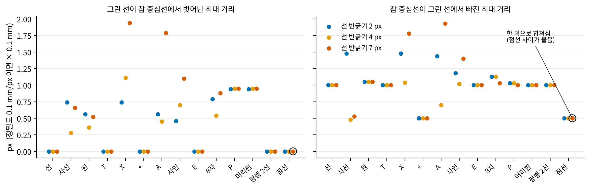
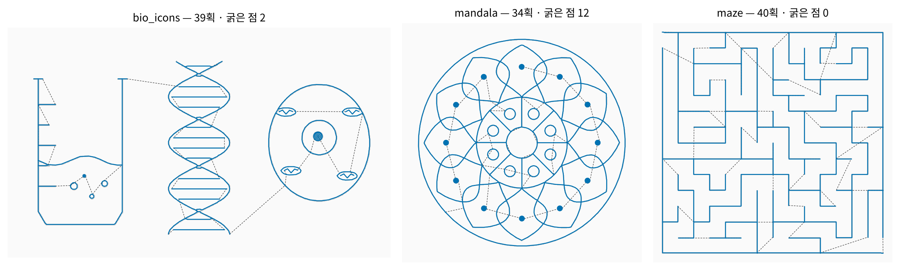
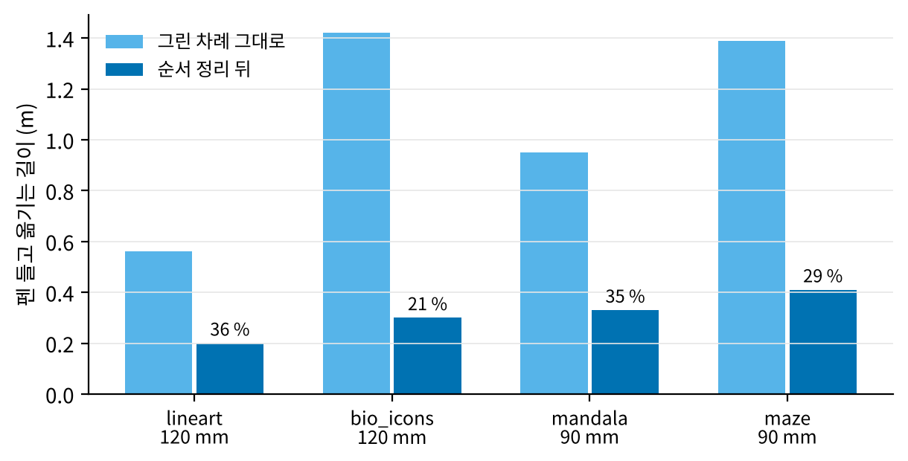

# 04. 사진 · 그림 → 선

처리는 모두 브라우저 안에서 한다(1200 px 그림 약 1 s). 결과 획은 `draw` 항목으로 작업에 들어간다.

## 네 방식

| 방식 | 그리는 것 | 맞는 그림 |
|---|---|---|
| 중심선 (기본) | 선의 가운데를 한 번 | 선 그림 · 글씨 · 도면 |
| 윤곽선 | 검은 곳 테두리 (마칭 스퀘어) | 채운 모양의 외곽 |
| 채우기 선 | 검은 곳 안을 가로줄로 | 채운 면 |
| 둘 다 | 윤곽선 + 채우기 선 | 사진 |



## 칸

| 칸 | 기본 | 뜻 |
|---|---|---|
| 문턱 | 비움 = 자동(Otsu) | 1 – 254, 이보다 어두우면 그림 |
| 밝은 쪽을 그림 | 끔 | 검은 바탕의 흰 선 |
| 폭 mm | 80 | 그림 가로 크기. 세로는 비율대로 |
| 정밀도 mm/px | 0.1 | 그림을 이 크기 화소로 다시 그려 처리 (200 – 1400 px, 160만 화소까지) |
| 티 지우기 mm² | 0.3 | 이보다 작은 점 · 구멍은 지움 |
| 다듬기 px | 0.8 | 선을 줄일 때 허용 오차 |
| 짧은 선 버림 mm | 1 | 이보다 짧은 획 버림(점은 남김) |
| 채우기 간격 mm | 1.5 | 채우기 선 사이 |
| 왼쪽 아래 x · y · 높이 z | 10 · 10 · 0 | 판 위 자리 |
| 펜 굵기 mm (중심선) | 0.5 | 선 끝을 반지름만큼 덜 그음 · 굵은 점 나선 간격 |
| 잔가지 버림 mm (중심선) | 1 | 선 옆 짧은 가지 버림 (선 굵기 + 1 px 보다 작게는 안 함) |
| 이음 mm | 0.3 | 이보다 가까운 획 끝은 펜을 들지 않고 이음 |
| 선 끝까지 | 켬 | 선 끝을 검은 곳 끝 − 펜 반지름까지 늘림 |
| 순서 정리 | 켬 | 펜 들고 옮기는 길이를 줄이도록 순서 · 방향을 바꿈 |
| 굵은 점 채우기 | 켬 | 펜보다 큰 점을 안쪽부터 나선으로 채움 |

미리보기를 누르면 크게 보인다. 아래 글에 획 수 · 펜 들기 · 그리기 · 옮기기 길이(정리 전 포함) · 화소 · 문턱 · 선 굵기 가운데값 · 지운 티 · 구멍이 나온다. 걸리는 시간은 작업에 넣은 뒤 [계획 보기]에 나온다.

## 중심선 처리



1. **흑백** — 회색값에 문턱(자동 = Otsu).
2. **크기** — 폭 ÷ 정밀도 만큼의 화소로 다시 그린다.
3. **티 · 구멍** — 면적이 기준보다 작은 검은 덩어리 · 흰 구멍을 지운다.
4. **가장자리 다듬기** — 선 반굵기 가운데값이 1.5 px 이상이면 3 × 3 다수결로 가장자리 한 화소 혹 · 홈을 지운다.
5. **골격** — Zhang–Suen 세선화 후 남는 군더더기 화소를 지운다. 세선화에서 통째로 사라진 작은 덩어리는 가장 굵은 곳에 한 점을 남긴다.
6. **골격 그래프** — 끝 · 갈림 화소를 노드로, 그 사이를 가지로 묶는다.
7. **정리** — 선 굵기보다 짧은 잔가지를 버린다(버린 자리는 기억). 서로 가까운 갈림 노드는 하나로 합친다(X 교차가 두 갈림으로 갈라지는 것 방지).
8. **노드 종류** — 갈림(J) · 모서리(C, 잔가지를 버린 자리이면서 남은 두 가지가 148° 보다 꺾인 곳) · 끝(T) · 지남(P).
9. **갈림에서 잇기** — 갈림에 모인 가지를 둘씩 짝짓는다. 가장 곧게 이어지는 짝(방향 내적 > 0.34)부터. 거의 곧으면(> 0.94) 곧게, 아니면 노드 가운데를 지나 잇는다. 짝이 없는 가지 끝은 그 갈림을 지나는 다리까지 곧게 늘린다(T 의 기둥이 가로선에 닿게).
10. **선 끝** — 끝(T)은 바깥 방향으로 검은 곳 끝까지 나아간 뒤 펜 반지름만큼 뺀 자리까지 늘린다.
11. **모서리** — 크게 꺾이는 구간의 가운데에서 앞뒤 곧은 다리를 직선으로 맞춰 두 직선의 교점을 모서리로 둔다(다리가 곧지 않으면 하지 않음).
12. **매끄럽게 · 줄이기** — 모서리 · 다리 끝을 고정점으로 두고 가우스(σ 1 px)로 다듬은 뒤, 고정점을 지키는 RDP 로 점을 줄인다.
13. **점** — 원래 떨어진 한 점 덩어리, 그리고 길이가 굵기 + 1 px 이하인 토막은 점이다. 펜보다 큰 점은 반지름 − 펜 반지름까지 간격 1.6 × 펜 반지름의 나선으로 채운다.
14. **순서** — 시작 자리(판 원점)에서 가장 가까운 획 끝부터 고르기(획 뒤집기 · 닫힌 획은 시작점 돌리기 포함) → 2-opt(600 ms 까지) → 이음 거리 안의 끝은 한 획으로 잇는다. 그리는 길이는 바뀌지 않는다.

## 결과



- 합성 도형 14종 × 선 반굵기 2 · 4 · 7 px = 42 경우 중 41 통과.
  - 통과 기준: 획 수가 맞고, 벗어남 · 빠짐이 1.5 + 0.15 × 반굵기 px 이하.
  - 안 된 1 경우는 반굵기 7 px 점선이다. 점선 사이 간격이 선 굵기보다 좁아 그림에서 이미 붙어 있다.
- 원(그림 900 px · 선 굵기 14 px → 폭 120 mm)의 중심선 반지름 오차 최대 **0.124 mm** (선 굵기 1.87 mm).
- 무작위 선 그림 150개: 멈춤 · NaN 없음.



| 그림 | 폭 | 획 | 펜 들기 | 그리기 | 옮기기 (정리 전 → 뒤) | 처리 |
|---|---|---|---|---|---|---|
| bio_icons | 120 mm | 45 | 44 | 0.79 m | 1.42 → 0.30 m | 1.5 s |
| mandala | 90 mm | 32 | 31 | 1.38 m | 0.95 → 0.33 m | 1.4 s |
| maze | 90 mm | 40 | 39 | 1.31 m | 1.39 → 0.41 m | 1.1 s |



## 쓰는 법

- 선 그림은 검은 선 · 흰 바탕, 선 굵기 3 px 이상이 좋다. 얇은 스캔은 정밀도를 줄여(0.05) 처리한다.
- 사진은 중심선보다 윤곽선 · 채우기 선이 맞다.
- 획이 너무 많으면(3000 넘음) 정밀도 · 짧은 선 버림 · 티 지우기를 키운다.
- 펜 굵기 칸은 실제 펜 굵기로 맞춘다. 0 이면 선 끝을 덜 긋지 않고, 굵은 점도 채우지 않는다.

## 시험 코드

`tests/centerline/` — `center.js` 는 fr5print.py 0.2.0 안에 그대로 들어 있는 코드다.

```bash
cd tests/centerline
NOBIG=1 node t_center.js            # 합성 도형 42 경우
for s in $(seq 1 150); do node t_fuzz.js $s || echo "seed $s"; done
```
