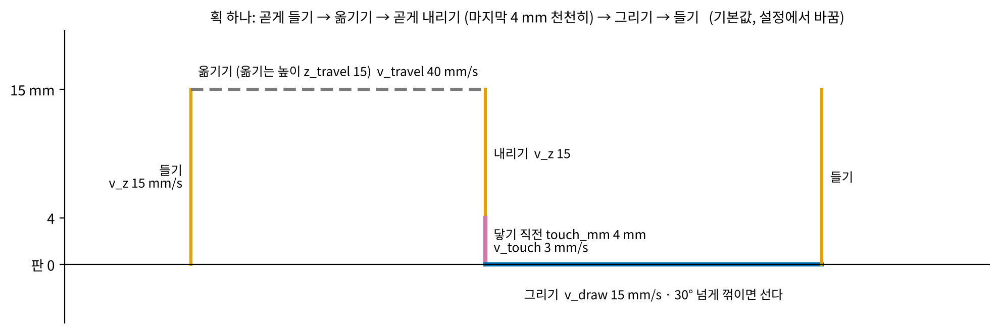

# 05. 계획 · 검사

[계획 보기]는 로봇을 움직이지 않는다. 작업 전체를 관절 50 Hz 명령으로 바꾸고 검사한다. 하나라도 걸리면 보내지 않는다.

## 길

- 획마다: 지금 자리 → 옮기는 높이로 곧게 들기 → 그 높이로 옮기기 → 곧게 내리기(마지막 touch_mm 은 v_touch 로 천천히) → 그리기 → 들기.
- 점(배열 찍기): 칸 위로 옮김 → 곧게 내림 → 그리퍼 먼저 · 기다리기 · 그리퍼 나중 → 들기.
- 끝: 처음 자리가 옮기는 높이 위면 처음 자리로 돌아간다(`back`). 아니면 마지막 자리 위로 들어 둔다.
- 손 방향은 시작 자세 그대로다. 공구 끝만 움직인다.

## 시간 계산

1. 그리기는 0.5 mm, 옮기기는 1.5 mm 간격으로 공구 끝 길을 다시 찍고, 점마다 IK(앞 점에서 이어 풀기)를 푼다.
2. 점마다 속도 한도 = min(정한 속도, √(가속 / 굽음), 관절 최고 속도 / 관절 °/mm).
3. 30° 넘게 꺾이는 곳(옮기기는 40°)에서는 선다.
4. 앞뒤로 가속 한도를 지켜 속도를 정하고, 선 곳마다 끊어 가우스(σ 0.08 s)로 가속 꺾임을 무르게 한다.
5. 50 Hz 로 관절 명령을 뽑는다.

## 검사

| 검사 | 기준 |
|---|---|
| 관절 한계 · J6 창 · 손목 특이점(|J5|) | pour_run 의 값 |
| IK | 위치 오차 0.5 mm 넘으면 거절 |
| 판 아래 | 공구 끝이 판보다 z_below 넘게 아래 |
| 판 밖 | 판 가까이(옮기는 높이 아래)에서 판 + margin 밖 |
| 작업 상자 | TCP · 공구 끝 x −260 – 330 · y 300 – 720 · z 620 mm 까지 (베이스) |
| 책상 | 공구 끝이 책상 높이 − 1 mm 아래 |
| 가장 높은 동작 | 판 위 z_max 넘음 |
| 시간 · 길이 | 2 시간 · 60 m 넘으면 나눠서 |

계획 요약에 동작 수 · 시간 · 그리기/옮기기 길이 · 공구 끝 최고 속도 · 닿기 직전 최고 속도 · 관절 최고 속도 · 서는 꼭짓점 수 · 높이 범위 · 공구 축과 판 법선 각 · J5 최소 · J6 범위 · 정한 길과의 차 · IK 오차 · 계획 시간이 나온다.

계획 뒤 로봇 · 공구 길이 · 판 · 설정 · 작업이 바뀌면 그 계획은 거절되고 다시 계획해야 한다.

## 설정

| 키 | 화면 이름 | 기본 | 범위 |
|---|---|---|---|
| `v_draw` | 그리기 mm/s | 15 | 1 – 60 |
| `v_travel` | 옮기기 mm/s | 40 | 5 – 60 |
| `v_z` | 올리고 내리기 mm/s | 15 | 2 – 30 |
| `v_touch` | 닿기 직전 mm/s | 3 | 0.5 – 10 |
| `touch_mm` | 닿기 직전 구간 mm | 4 | 0 – 20 |
| `z_travel` | 옮기는 높이 mm | 15 | 2 – 100 |
| `acc` | 가속 mm/s² | 150 | 20 – 500 |
| `vj` | 관절 최고 °/s | 15 | 2 – 30 |
| `z_below` | 판 아래 허용 mm | 0 | 0 – 3 |
| `margin` | 판 밖 허용 mm | 0 | 0 – 50 |
| `ramp_s` | 그리퍼 바꾸는 시간 s | 1 | 0.2 – 10 |
| `z_max` | 가장 높은 동작 mm | 150 | 5 – 300 |
| `air_dz` | 허공 시험 판 위 mm | 0 (끔) | 0 – 100 |
| `tool_len` | 공구 길이 mm | 0 | 0 – 400 |
| `back` | 끝나면 처음 자리로 | 켬 | — |

설정은 `settings.json` 에 남는다. 움직이는 중에는 바꾸지 않는다.

## 시험 그림 계획 (판 150 × 100 mm, 옮기는 높이 5 mm, 나머지 기본값)

| 그림 | 동작 | 시간 | 그리기 · 옮기기 | 서는 꼭짓점 |
|---|---|---|---|---|
| bio_icons 120 mm | 45 | 6분 34초 | 786 · 952 mm | 18 |
| mandala 90 mm | 32 | 7분 31초 | 1373 · 822 mm | 46 |
| maze 90 mm | 40 | 7분 5초 | 1308 · 1075 mm | 54 |

옮기기 길이에는 들기 · 내리기가 들어 있다. 펜을 한 번 들 때마다 들기 · 옮기기 · 내리기 · 닿기 직전에 몇 초씩 걸린다.
