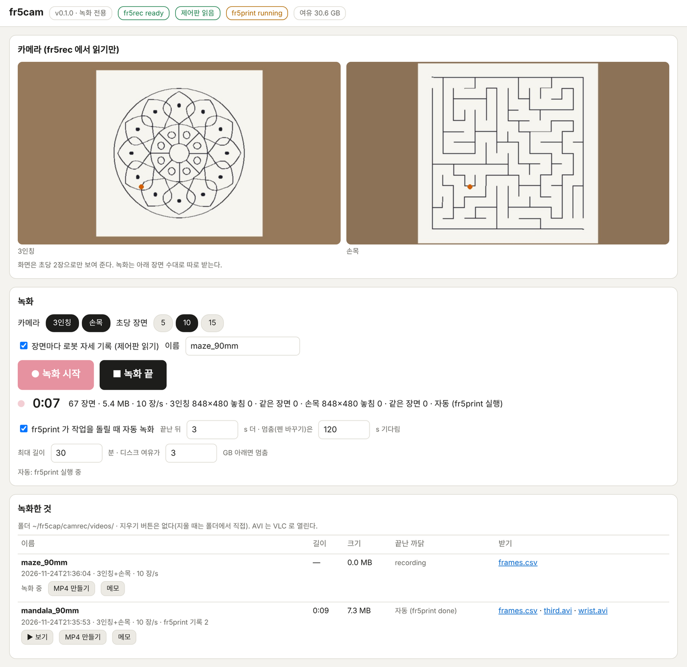
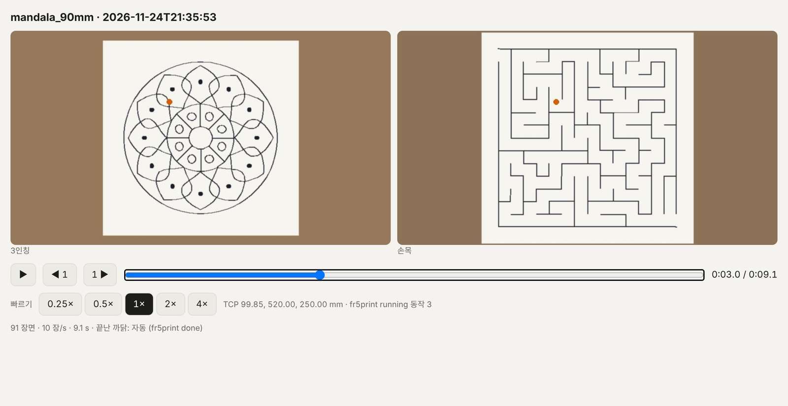

# 07. fr5cam — 작업 녹화

fr5print 와 따로 켜는 녹화 프로그램이다. 표준 라이브러리만 쓴다.

- 카메라는 수집 프로그램(fr5rec)이 열어 둔 것을 `GET /api/frame/<third|wrist>.jpg` 로 읽기만 한다. fr5rec 의 녹화 · 데이터셋 · 설정에는 아무것도 쓰지 않는다.
- 제어판 `/api/state`, fr5print `/api/pstatus` 도 읽기만 한다. POST 는 없다.
- 쓰는 곳은 `~/fr5cap/camrec/` 의 `settings.json` · `videos/` 뿐이다.

## 쓰는 법

| 칸 | 기본 | 뜻 |
|---|---|---|
| 카메라 | 3인칭 · 손목 | 하나 또는 둘 |
| 초당 장면 | 10 | 5 · 10 · 15 |
| 장면마다 로봇 자세 기록 | 켬 | 제어판을 장면 수만큼(최대 10 Hz) 읽어 CSV 에 남김 |
| 이름 | 비움 | 폴더 이름 뒤에 붙음 (영문 · 숫자 · 한글 · _ -) |
| fr5print 실행에 맞춰 자동 녹화 | 끔 | fr5print 가 작업을 돌리면 시작, 끝나면 tail_s 뒤 끝 |
| 끝난 뒤 s 더 | 3 | |
| 멈춤 기다림 s | 120 | fr5print 가 멈춤(펜 바꾸기 등)이면 이만큼 기다린 뒤 끝 |
| 최대 길이 분 | 30 | |
| 디스크 여유 GB | 3 | 이보다 적으면 시작하지 않고, 녹화 중이면 끝 |

- [● 녹화 시작] 은 카메라마다 프레임을 한 장 받아 본 뒤 시작한다. 못 받으면 까닭을 보이고 시작하지 않는다.
- 녹화 중에는 카메라 · 장면 수 · 자세 기록을 바꾸지 않는다.
- 위 화면 영상은 초당 2장으로만 보여 준다. 녹화 중에는 녹화한 장면을 그대로 보여 준다.

## 저장

`videos/<YYYYmmdd_HHMMSS>_<이름>/`

| 파일 | 내용 |
|---|---|
| `third.avi` · `wrist.avi` | MJPEG (fr5rec JPEG 그대로, 화질 90), 848 × 480. 1.9 GB 마다 `third_002.avi` … |
| `frames.csv` | 장면마다 한 줄 |
| `meta.json` | 녹화 정보 |
| `third.mp4` · `wrist.mp4` · `both.mp4` | [MP4 만들기] 뒤 (H.264, 둘 나란히 = both) |

`frames.csv` 열: `i, t_s, wall, <cam>_num, <cam>_age_ms, <cam>_src, mode, x, y, z, rx, ry, rz, j1 … j6, grip, print_state, print_op, print_k`

- `<cam>_num` = fr5rec 장면 번호, `<cam>_age_ms` = 받은 장면의 나이.
- `<cam>_src` = `new`(새 장면) · `same`(같은 장면 다시) · `miss`(못 받아 앞 장면 되풀이).
- TCP(mm · °, 베이스) · 관절(°) · 그리퍼(0 – 1000)는 1 s 안의 제어판 값만 쓴다.

`meta.json` 주요 키: `start` · `end` · `fps` · `cams` · `why_start` · `end_reason` · `frames` · `seconds` · `late_ticks` · `cam.<cam>.{files, frames, bytes, miss, dup, w, h}` · `print_runs`(fr5print 상태가 바뀐 시각 · 계획 id) · `note`.

## 시간

- 영상 시간 = 실제 시간이다. 장면을 받는 데 늦으면 놓친 박자만큼 앞 장면을 되풀이해 넣는다(`late_ticks`).
- 크기: 10 장/s · 두 카메라에서 분당 약 50 – 100 MB (장면 내용에 따라 다름).

## 끝나는 경우

[■ 녹화 끝] · 최대 길이 · 디스크 여유 부족 · fr5rec 프레임을 10 s 못 받음 · 자동 녹화의 끝 · 프로그램 끝(Ctrl+C).

## 갑자기 꺼졌을 때

- 다음에 켤 때 `state: recording` 으로 남은 녹화를 찾아, 남은 장면으로 AVI 를 다시 만든다.
- 원본은 `<cam>.avi.tmp.bak_<시각>` 으로 남긴다.
- 같은 포트를 이미 다른 fr5cam 이 쓰고 있으면 고치기 전에 멈춘다(녹화 중인 파일을 건드리지 않게).

## 보기 · 받기

- [▶ 보기]: 브라우저 안에서 장면을 돌려 본다. 속도 0.25 – 4×, ◀ 1 · 1 ▶, Space 재생/정지, ← → 한 장. 그 장면의 TCP 와 fr5print 상태가 함께 보인다.
- AVI · CSV · MP4 받기 링크. AVI 는 VLC 로 열린다.
- [MP4 만들기]: ffmpeg 가 있을 때만. `nice -n 19` 로 돈다. 녹화 중이거나 fr5print 가 작업 중이면 거절한다(로봇 제어 PC 부담).
- [메모]: 녹화에 500자까지 메모.
- 지우기 버튼은 없다.
