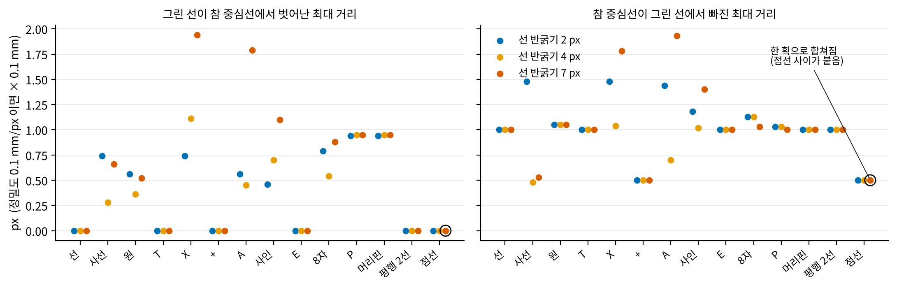

# 09. 시험 결과

시험은 가짜 제어판(관절 1차 지연으로 따라가는 모의 제어판)과 합성 그림으로 했다. 실물 결과는 마지막 절에 따로 적는다.

## fr5print 0.1.0 (2026-11-22)

| 묶음 | 통과 | 내용 |
|---|---|---|
| 계획기 | 74 | 글씨 · 도형 · G-code · SVG · 배열 계획. 정한 길과 차 0.004 mm, 그리기 최고 15 mm/s, 동작 6 부터 계획, 허공 +20 mm, 책상 아래 · 상자 밖 판 거절 |
| 서버 | 49 | 판 3점 · 계획 · 실행 · 획 끝에서 멈춤 · 이어서 · 멈춤 항목 · Space · 속도 50 % · 계획 뒤 바뀜 거절 · 판 밖 거절 · 모서리 확인 · 뒤처짐 · 제어판 꺼짐 · 다른 화면이 보내는 중 거절 · 작업 저장 · 파일 가져오기 · 실행 기록 |
| 화면 (Playwright) | 28 + 8 | 도형 · 글씨 · 손 그림 · 사진 → 획 · G-code · 가운데로 · 계획 · 미리 돌려보기 · 시작 → 끝 · 바뀌면 시작 꺼짐 · 저장/불러오기 · 바로 따라 그리기 3획 · Space 멈춤 · 콘솔 오류 0 · 390 px 넘침 없음 · 어두운 화면 |

## fr5print 0.2.0 (2026-11-24)

| 묶음 | 결과 |
|---|---|
| 합성 도형 (선 · 사선 · 원 · T · X · + · A · 사인 · E · 8자 · P · 머리핀 · 평행 2선 · 점선) × 반굵기 2 · 4 · 7 px | 41 / 42 통과. 안 된 1 = 반굵기 7 px 점선(그림에서 이미 붙음) |
| 무작위 선 그림 | 150 / 150 멈춤 · NaN 없음 |
| 화면 시험 | 18 / 18: 기본 = 중심선 · 원 중심선 반지름 오차 최대 0.124 mm · 옮기기 0.56 → 0.20 m · 굵은 점 5개 나선 · 모드 바꾸기 · 순서 정리 끄기 · 계획 검사 통과 · 실행 끝 · 콘솔 오류 0 · 390 px 넘침 0 |
| 시험 그림 계획 | 3 / 3 검사 통과 ([05_planning](05_planning.md)) |

## fr5cam 0.1.0 (2026-11-24) — 46 / 46

| 항목 | 결과 |
|---|---|
| AVI | 25 장 쓰기 → ffprobe mjpeg 25 장 · 10/1 fps, 색인 읽기 |
| 녹화 6.1 s · 10 장/s | 61 장, 두 AVI 모두 61 장 · 848 × 480, CSV 61 줄 · TCP 채움, 장면 번호 늘어남 |
| 늦는 fr5rec (9 번째 요청마다 350 ms) | 6.1 s 에 61 장 — 영상 시간 = 실제 시간, 늦은 박자 15 |
| 자동 녹화 | idle → 안 함 · 실행 → 시작 · 멈춤 2.5 s → 이어 녹화 · 끝 1 s → 아직 · 끝 3 s → 끝, 상태 바뀜 기록 |
| MP4 | fr5print 실행 중 거절 · third.mp4 h264 61 장 · both.mp4 1696 × 480 |
| 받기 | Range 206 · CSV 첨부 · 보기 장면 |
| 끊김 | fr5rec 끊김 10 s → 끝 · fr5rec 없으면 시작 거절 |
| 갑자기 꺼짐 | kill -9 → 다시 켜면 40 장 AVI 로 고침 · 원본 보관 · 포트를 쓰는 중이면 고치지 않음 |
| 보안 | JSON 아닌 POST · 다른 Host 거절 |
| 화면 | 실시간 장면 · 버튼 녹화 · 목록 · 보기 재생 · 390 px 넘침 0 · 콘솔 오류 0 |

## 실물 (FR5, 2026-11-24)

| 항목 | 결과 |
|---|---|
| 허공 시험 → 펜 그리기 | 도형 · 글씨 작업이 판 위에 그려짐 |
| 판 맞추기 | 1점 + 크기, 펜 끝이 판에 닿은 높이에서 저장 |
| 멈춤 뒤 이어서 | 모서리 확인 중 추종 정지(뒤처짐 6.7°)로 멈춘 뒤 [이어서]로 끝까지 |
| 실물 선 위치 오차 · 누르는 힘 | 미측정 |
